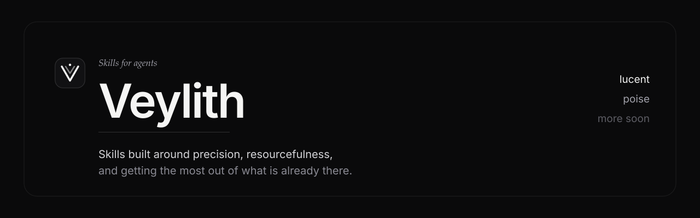

# Veylith

**Skills built on one premise: get the most out of what is already there.** Each skill takes a
single discipline seriously, writes down the rules that discipline actually has, and refuses to
stretch them over work they were never meant for.

[](LICENSE)
[](https://skills.sh)
[](skills)

The ideas that hold across the collection:

- **Prefer the platform.** A CSS transition over an animation library. Native scroll over smooth
  scroll. What the project already ships over what it could install.
- **One of each thing.** One design system, one animation engine, one scroll owner, one authored
  moment per surface. Two of anything produces work that looks like two products.
- **A dependency is a liability.** Every library in a brief is bundle weight, maintenance, and a
  future upgrade. It has to earn its place in one sentence.
- **Hand off instead of bundling.** Where a job belongs to another skill, these skills name it,
  ask before installing it, and install exactly that one skill.
- **Say the cost.** Bundle size, render time, or upkeep — in one line, in the report.

No installer, no bundle, no companion skill that arrives uninvited.

## The collection

| Skill | Discipline | What it does |
|---|---|---|
| **[autopilot](skills/autopilot/SKILL.md)** | Autonomy | Asks everything that could block the work in one pass, then finishes alone and logs every decision, assumption and blocker in `decisions.md` for the user to review on return. |
| **[blueprint](skills/blueprint/SKILL.md)** | Intent and agreement | Uses native questions to establish the brief, asks how many prototypes to explore, refines the chosen design, and implements when the user says to proceed. |
| **[decision-review](skills/decision-review/SKILL.md)** | Sign-off | Checks every decision and assumption in `decisions.md` against what was actually built, then asks the user one at a time to keep or change it, applies the answers, and updates the record. |
| **[handoff](skills/handoff/SKILL.md)** | Continuity | Replaces `HANDOFF.md` in the current directory with concise user-message summaries, completed work, every changed file, verification, and next steps. |
| **[lucent](skills/lucent/SKILL.md)** | Clarity and precision | Any creative or interface work — any app, website, product, or anything else. Turns a vague brief into a finished design: direction, design system, fundamentals, any effect that earns its place, and the audit. |
| **[poise](skills/poise/SKILL.md)** | Composure and control | Any review of design work, your own or existing. Makes output look confident without trying to look sophisticated — removes generic AI-looking habits and settles hierarchy, spacing, type, and motion across web, print, decks, and video. |
| **[office](skills/office/SKILL.md)** | Production | Makes real documents, decks, sheets, PDFs, images, vectors, video, motion graphics and audio in the ArtCraft app suite, one code-mode call at a time, and asks before installing an app that is missing. |

More skills are landing. Each is a folder with a `SKILL.md`, installable on its own.

---

## Install

Built on the [skills](https://skills.sh) CLI from
[vercel-labs/skills](https://github.com/vercel-labs/skills). **Node 22.20+ required.**

```bash
npx skills add asterxsk/veylith --skill autopilot -g
npx skills add asterxsk/veylith --skill blueprint -g
npx skills add asterxsk/veylith --skill decision-review -g
npx skills add asterxsk/veylith --skill handoff -g
npx skills add asterxsk/veylith --skill lucent -g
npx skills add asterxsk/veylith --skill office -g
npx skills add asterxsk/veylith --skill poise -g
```

Or install everything in the collection:

```bash
npx skills add asterxsk/veylith -g
```

Drop `-g` to install into the current project instead of your user directory, and `-a
claude-code` (or `-a cursor`, and so on) to target one agent. Restart the agent afterwards.

A skill is just a folder with a `SKILL.md` in it, so cloning works too:

```bash
git clone --depth 1 https://github.com/asterxsk/veylith /tmp/veylith
cp -r /tmp/veylith/skills/lucent ~/.claude/skills/lucent
```

---

## Autopilot

[autopilot](skills/autopilot/SKILL.md) runs a task while the user is not there. It collects every
question that could block the work in a single pass through the native question tool, tells the
user once that they can go, and then works unattended: planning, implementing, reviewing and
verifying without asking for anything else.

Every choice made in their absence is appended to `decisions.md` in the working directory as it
happens — what was decided, why, which alternatives were rejected, how reversible it is, what
happens if it is wrong. Assumptions and blockers are logged separately. When the work is finished
the file is closed out and summarised in chat, so the record is the first thing the user reads
back.

The rule that keeps it safe unattended: nothing irreversible and nothing outward-facing is done
alone. No force-pushes, no deletions it cannot undo, no pushes, publishes, deploys, installs, or
spending. Those become blocker entries with the exact action that would resume them, and the work
stops at the last clean, running state.

```bash
npx skills add asterxsk/veylith --skill autopilot -g
```

---

## Decision Review

[decision-review](skills/decision-review/SKILL.md) is the counterpart to Autopilot: the pass the
user makes when they come back. It reads `decisions.md`, checks each entry against the actual
work — applied, drifted, never implemented, or unverifiable — and adds anything the work changed
that nobody recorded. Then it asks, one entry at a time through the native question tool: keep it,
change it, or revert it where a clean undo exists.

Entries are ordered by consequence, so the hard-to-reverse and unrecorded ones come first. The
approved changes are implemented and verified, the review section is appended to `decisions.md`
with the verdict on each entry, and the chat summary says what changed and what is still open.

When the file holds no decisions and no assumptions, the skill says so in one line and stops.
There is nothing to review, and no review is invented to fill the silence.

```bash
npx skills add asterxsk/veylith --skill decision-review -g
```

---

## Blueprint

[blueprint](skills/blueprint/SKILL.md) combines brainstorming, probing questions, and runnable
prototypes in one workflow. It uses the harness's native question tool to establish shared
understanding, then asks the user how many distinct prototypes to compare. The user can select
or combine directions and refine them for as many rounds as needed. Implementation begins when
the user says to proceed, including an explicit request to skip prototypes.

Plans and long documents stay in markdown files. Blueprint works on its own; Lucent can guide
the interface implementation and poise can make the finishing pass when available.

```bash
npx skills add asterxsk/veylith --skill blueprint -g
```

---

## Handoff

[handoff](skills/handoff/SKILL.md) writes a compact `HANDOFF.md` in the directory where you
invoke it. It summarizes every user message through the previous turn, completed work,
all changed files, verification, and what the next session should do. Each invocation
replaces the previous handoff completely, keeping one current record instead of a growing log.

Invoke `$handoff`, optionally with the next session's focus. It returns only the saved file's
path; its Codex invocation policy remains explicit-only.

```bash
npx skills add asterxsk/veylith --skill handoff -g
```

---

## Lucent

**A design skill for turning a vague brief into an interface that is easy to understand and built
from the least it can be built from.**

Most design skills give an agent a look. Lucent gives it an order of operations and a budget.
It reads the project before recommending anything, prefers the platform before a package, and
treats "use what is already installed" as the default answer rather than the fallback.

### The loop

```
read the brief      →  three dials, a mode, a refusal list
choose the substrate →  one design system, detected or chosen
settle fundamentals →  hierarchy, spacing, type, colour, states
add an effect       →  only if it survives one sentence
audit once          →  one batched pass, then stop
```

Each step except the first, third, and last can be skipped with a stated reason. None can be
skipped silently.

### It is self-contained

Direction, the design system, the fundamentals, the effects, and the audit all live in the skill.
Nothing else has to be installed for it to work.

| What Lucent owns | Reference |
|---|---|
| The three dials, the mode, and the patterns it refuses | [direction.md](skills/lucent/reference/direction.md) |
| The seven core design systems, plus the enterprise ones for named brands | [design-systems.md](skills/lucent/reference/design-systems.md) |
| Hierarchy, spacing, type, colour, layout, states, accessibility floor | [fundamentals.md](skills/lucent/reference/fundamentals.md) |
| Which effect belongs where, and where every one of them is wrong | [usage-map.md](skills/lucent/reference/usage-map.md) |
| The pre-flight and interface checklist | [audit.md](skills/lucent/reference/audit.md) |
| Small labels: serif italic, sentence case, untracked — the one cross-medium rule | [labels.md](skills/lucent/reference/labels.md) |

### Design systems

Well-known, general-purpose systems only. Detected from `package.json` before anything is
recommended, and exactly one per project.

| System | Pick it when | Stack |
|---|---|---|
| **shadcn/ui** | You want to own the component source | React, Tailwind v4 |
| **HeroUI** | Polished and accessible without owning it | React 19, Tailwind v4, React Aria |
| **Mantine** | React without Tailwind, or a full kit | React, CSS modules |
| **Base UI** · **Radix Primitives** | You are authoring the design system itself | React, unstyled |
| **React Aria Components** | Accessibility is audited, not assumed | React, unstyled |
| **daisyUI** | Not React, or no JS behaviour needed | Any, CSS only |

Plus the named-brand systems for when the brand *is* the brief: Material UI, IBM Carbon, Fluent
UI, GitHub Primer, React Spectrum, Shopify Polaris, Ant Design. Details, versions, licences, and
exit costs in [design-systems.md](skills/lucent/reference/design-systems.md).

### The effect layer

Three technologies, each written as a rule sheet rather than a tutorial.

| Need | Reference |
|---|---|
| Motion, scroll-linked reveals, parallax, and smooth scroll | [motion.md](skills/lucent/reference/motion.md) — Motion and Lenis |
| Code-authored 3D, or a designer-supplied Spline scene | [three-d.md](skills/lucent/reference/three-d.md) — react-three-fiber and Spline |
| Glass, liquid marks, animated gradient backgrounds | [surfaces.md](skills/lucent/reference/surfaces.md) |

Before building any of them, check [ui-registries.md](skills/lucent/reference/ui-registries.md) —
Cult UI, Kokonut UI, Skiper UI, Watermelon UI, and interior.dev ship free copy-paste versions of
all three.
When the *section* is undecided rather than the effect, [design-galleries.md](skills/lucent/reference/design-galleries.md)
collects real shipped hero, navbar, CTA, footer, and pricing sections to calibrate against.

### Illustrations and diagrams

When the website needs an SVG illustration, an empty-state figure, or a conceptual diagram,
Lucent can use **Hairline**: reuse a suitable premade figure or create one with `hairline-create`.
The [Hairline reference](skills/lucent/reference/hairline.md) covers static SVG output and
optional interaction. A still SVG needs no Hairline runtime; the skill stays an optional handoff.

When the picture is of a product — an app in a hero, a feature card, a bento tile, or a short demo
with a cursor — the [faux UI reference](skills/lucent/reference/faux-ui.md) covers how to frame,
crop, restrain, and animate it so it reads as a product shot rather than a screenshot in a box.
`stageshow` supplies the React kit and gold examples; the rules work without it.

### What it hands off

Lucent covers the interface. Everything else is a named handoff:

| The brief is | The skill |
|---|---|
| An SVG illustration, isometric figure, or conceptual diagram | `hairline-create` |
| A product mockup or animated app demo | [faux-ui.md](skills/lucent/reference/faux-ui.md) — by hand, or `stageshow` for the kit |
| A document, spreadsheet, presentation, PDF, photo edit, vector logo, or audio file | `office` |
| A video you will edit, or a motion graphic with keyframes | `office` — ask first: `hyperframes` or FilmCraft/EffectCraft |
| A rendered video, HTML-built motion graphic, or live slideshow | `hyperframes` |
| Music, SFX, voiceover, stock media | `media-use` |
| A chart, graph, or dashboard metric | `dataviz` |
| Android or iOS native screens | `android-native-dev`, `mobile-android-design` |
| A polish pass on a finished artifact | `poise` |

[office](skills/office/SKILL.md) is the default for real office files and creative media, except
FigCraft and DesignCraft — those are skipped in favour of Figma or Pen.dev.

The protocol, spelled out in [handoffs.md](skills/lucent/reference/handoffs.md):

1. Detect whether the skill is already installed.
2. Ask once, with the exact command and what it adds.
3. Install only on approval — **one skill, never a pack**.
4. Say if a restart is needed.
5. If installing is impossible, state the limit and use the narrowest fallback that needs no new
   dependency.

Nothing in this repository installs anything else. That is the point.

---

## poise

[poise](skills/poise/SKILL.md) is the review pass over design work, your own or already built.
It improves hierarchy, spacing, typography, graphics, and motion across websites, interfaces,
PDFs, posters, decks, and videos. Use it to prune repetitive dividers, decorative uppercase
monospace, clutter, and effects that compete with the message, while preserving the brief,
brand, and meaningful character.

It works on its own, with no libraries and no dependencies. When paired with Lucent, Lucent
settles the fundamentals and builds; once the design is done, Lucent runs poise as a subagent for
the finishing pass and checks the composed result.

```bash
npx skills add asterxsk/veylith --skill poise -g
```

---

## Office

[office](skills/office/SKILL.md) does the production work: documents, decks, spreadsheets, PDFs,
image editing, vector illustration, video, motion graphics and audio, in the ArtCraft suite.
Thirteen native apps, one contract — every app has a CLI, a JSON command channel and an MCP
server, and every ribbon button is a command an agent can run.

Seven of them are already wired through **code mode**, a single MCP server whose one `exec` tool
runs JavaScript against the others. That matters: registering the suite directly puts more than
three hundred tool schemas into context before any work starts, and PdfCraft alone has 179. With
code mode, one call does the discovery, the work and the reduction, and only the result comes
back. Codex and Pi have code mode built in; Claude Code does not, so the skill installs it as one
stdio server and says so when it does.

| App | Makes |
|---|---|
| WordCraft · DeckCraft · GridCraft | `.docx`, `.pptx`, `.xlsx` |
| PdfCraft | combine, split, forms, redaction, OCR, signing, PDF/A |
| PhotoCraft · VectorCraft | `.psd` and `.pcraft`, `.ai` and `.svg` |
| FilmCraft · EffectCraft · SoundCraft | cuts, motion graphics, mixed audio |
| DesignCraft · FigCraft · CADCraft · LightCraft | print layout, prototypes, drawings, raw photo |

The rules are the collection's rules. Locate the app that owns the artifact. Ask before installing
anything that is missing, and name the exact command when you ask. Drive commands rather than
pixels. Render the result before calling it finished. Hand judgement work — how the deck should
feel, whether the chart is honest — to poise, dataviz or lucent.

```bash
npx skills add asterxsk/veylith --skill office -g
```

---

## Repository layout

```
skills/autopilot/
├── SKILL.md                    preflight questions, unattended work, decisions.md
└── agents/openai.yaml          display name and default prompt
skills/blueprint/
├── SKILL.md                    native questions, discovery, prototypes, and implementation
└── agents/openai.yaml          display name and default prompt
skills/decision-review/
├── SKILL.md                    verify decisions.md, ask keep or change, apply, update
└── agents/openai.yaml          display name and default prompt
skills/handoff/
├── SKILL.md                    concise session handoff, replaced on each invocation
└── agents/openai.yaml          display name, default prompt, and explicit invocation policy
skills/lucent/
├── SKILL.md                    the loop, the contracts, the handoff protocol
└── reference/
    ├── mediums.md              what is being made, and what that changes
    ├── direction.md            three dials, mode, the refusal list
    ├── design-systems.md       the seven core systems plus the named brands
    ├── fundamentals.md         hierarchy, spacing, type, colour, states, a11y
    ├── hairline.md             premade figures, custom illustrations, static SVG output
    ├── faux-ui.md              product shots and demo animation: framing, restraint, motion
    ├── usage-map.md            where each effect belongs, and where it does not
    ├── motion.md               Motion and Lenis, and the scroll-ownership rule
    ├── three-d.md              react-three-fiber and Spline
    ├── surfaces.md             liquid glass, liquid logo, animated gradients
    ├── labels.md               the one rule that does not change with the medium
    ├── audit.md                the batched pre-flight and interface checklist
    ├── handoffs.md             what to install, when, and how to ask
    ├── design-references.md     the DESIGN.md catalogue and how the layers sequence
    ├── design-galleries.md     hero, pricing, navbar, CTA, and footer galleries
    └── ui-registries.md        Cult UI, Kokonut UI, Skiper UI, Watermelon UI, interior.dev
skills/poise/
├── SKILL.md                    standalone cleanup and pairing with Lucent
├── agents/openai.yaml          display name and default prompt for non-Claude agents
└── references/
    ├── mediums.md              inspection and verification by medium
    └── poster-calibration.md   concrete poster cleanup comparison
skills/office/
├── SKILL.md                    the loop, code mode, and the install-consent rule
├── agents/openai.yaml          display name and default prompt
└── reference/
    ├── apps.md                 every app: MCP server, CLI, tools, formats, limits
    ├── setup.md                detection, the three consent questions, registration
    ├── codemode.md             the exec runtime, call patterns, verification
    └── workflows.md            per-medium recipes and cross-app chains
assets/                         banner and mark
```

## Credits

Builds on the work of [`pmndrs/react-three-fiber`](https://github.com/pmndrs/react-three-fiber),
[Spline](https://spline.design), [`motion`](https://motion.dev),
[`darkroomengineering/lenis`](https://github.com/darkroomengineering/lenis),
[`nolly-studio/cult-ui`](https://github.com/nolly-studio/cult-ui), [Kokonut UI](https://kokonutui.com),
[Skiper UI](https://skiperui.com), [`WatermelonCorp`](https://github.com/WatermelonCorp),
[`VoltAgent/awesome-design-md`](https://github.com/VoltAgent/awesome-design-md),
[`lucasmarkes/hairline`](https://github.com/lucasmarkes/hairline),
[`benjitaylor/skills`](https://github.com/benjitaylor/skills) (stageshow), the
[ArtCraft](https://getartcraft.com) Crafting Apps and
[`tmustier/code-mode-mcp`](https://github.com/tmustier/code-mode-mcp), and the
[skills](https://github.com/vercel-labs/skills) CLI. The design systems documented in
[design-systems.md](skills/lucent/reference/design-systems.md) belong to their own authors; this
repository documents how to choose and use them well, and documents their free tiers only.

## License

[MIT](LICENSE)
