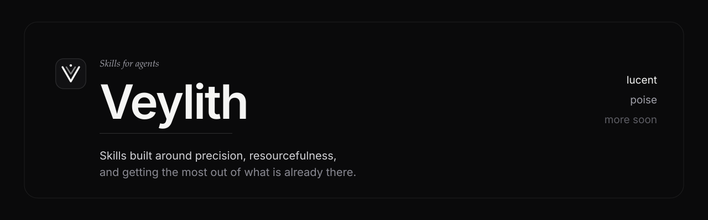

# Veylith

**Skills built on one premise: get the most out of what is already there.** Each skill takes a
single discipline seriously, writes down the rules that discipline actually has, and refuses to
stretch them over work they were never meant for.

[](LICENSE)
[](https://skills.sh)
[](skills)
[](skills/lucent/reference/handoffs.md)

The ideas that hold across the collection:

- **Prefer the platform.** A CSS transition over an animation library. Native scroll over smooth
  scroll. What the project already ships over what it could install.
- **One of each thing.** One design system, one animation engine, one scroll owner, one authored
  moment per surface. Two of anything produces work that looks like two products.
- **A dependency is a liability.** Every library in a brief is bundle weight, maintenance, and a
  future upgrade. It has to earn its place in one sentence.
- **Hand off instead of bundling.** Where a job belongs to another skill, these skills name it,
  ask before installing it, and install exactly that one skill.
- **Say the cost.** Bundle size, render time, or upkeep — in one line, in the report.

No installer, no bundle, no companion skill that arrives uninvited.

## The collection

| Skill | Discipline | What it does |
|---|---|---|
| **[blueprint](skills/blueprint/SKILL.md)** | Intent and agreement | Uses native questions to establish the brief, asks how many prototypes to explore, refines the chosen design, and implements when the user says to proceed. |
| **[lucent](skills/lucent/SKILL.md)** | Clarity and precision | Turns a vague requirement into a polished, legible interface — direction, design system, fundamentals, any effect that earns its place, and the audit. |
| **[poise](skills/poise/SKILL.md)** | Composure and control | Makes output look confident without trying to look sophisticated — removes generic AI-looking habits and settles hierarchy, spacing, type, and motion across web, print, decks, and video. |

More skills are landing. Each is a folder with a `SKILL.md`, installable on its own.

---

## Install

Built on the [skills](https://skills.sh) CLI from
[vercel-labs/skills](https://github.com/vercel-labs/skills). **Node 22.20+ required.**

```bash
npx skills add asterxsk/veylith --skill blueprint -g -y
npx skills add asterxsk/veylith --skill lucent -g -y
npx skills add asterxsk/veylith --skill poise  -g -y
```

Or install everything in the collection:

```bash
npx skills add asterxsk/veylith -g -y
```

Drop `-g` to install into the current project instead of your user directory, and `-a
claude-code` (or `-a cursor`, and so on) to target one agent. Restart the agent afterwards.

A skill is just a folder with a `SKILL.md` in it, so cloning works too:

```bash
git clone --depth 1 https://github.com/asterxsk/veylith /tmp/veylith
cp -r /tmp/veylith/skills/lucent ~/.claude/skills/lucent
```

---

## Blueprint

[blueprint](skills/blueprint/SKILL.md) combines brainstorming, probing questions, and runnable
prototypes in one workflow. It uses the harness's native question tool to establish shared
understanding, then asks the user how many distinct prototypes to compare. The user can select
or combine directions and refine them for as many rounds as needed. Implementation begins when
the user says to proceed, including an explicit request to skip prototypes.

Plans and long documents stay in markdown files. Blueprint works on its own; Lucent can guide
the interface implementation and poise can make the finishing pass when available.

```bash
npx skills add asterxsk/veylith --skill blueprint -g -y
```

---

## Lucent

**A design skill for turning a vague brief into an interface that is easy to understand and built
from the least it can be built from.**

Most design skills give an agent a look. Lucent gives it an order of operations and a budget.
It reads the project before recommending anything, prefers the platform before a package, and
treats "use what is already installed" as the default answer rather than the fallback.

### The loop

```
read the brief      →  three dials, a mode, a refusal list
choose the substrate →  one design system, detected or chosen
settle fundamentals →  hierarchy, spacing, type, colour, states
add an effect       →  only if it survives one sentence
audit once          →  one batched pass, then stop
```

Each step except the first, third, and last can be skipped with a stated reason. None can be
skipped silently.

### It is self-contained

Direction, the design system, the fundamentals, the effects, and the audit all live in the skill.
Nothing else has to be installed for it to work.

| What Lucent owns | Reference |
|---|---|
| The three dials, the mode, and the patterns it refuses | [direction.md](skills/lucent/reference/direction.md) |
| The seven core design systems, plus the enterprise ones for named brands | [design-systems.md](skills/lucent/reference/design-systems.md) |
| Hierarchy, spacing, type, colour, layout, states, accessibility floor | [fundamentals.md](skills/lucent/reference/fundamentals.md) |
| Which effect belongs where, and where every one of them is wrong | [usage-map.md](skills/lucent/reference/usage-map.md) |
| The pre-flight and interface checklist | [audit.md](skills/lucent/reference/audit.md) |
| Small labels: serif italic, sentence case, untracked — the one cross-medium rule | [labels.md](skills/lucent/reference/labels.md) |

### Design systems

Well-known, general-purpose systems only. Detected from `package.json` before anything is
recommended, and exactly one per project.

| System | Pick it when | Stack |
|---|---|---|
| **shadcn/ui** | You want to own the component source | React, Tailwind v4 |
| **HeroUI** | Polished and accessible without owning it | React 19, Tailwind v4, React Aria |
| **Mantine** | React without Tailwind, or a full kit | React, CSS modules |
| **Base UI** · **Radix Primitives** | You are authoring the design system itself | React, unstyled |
| **React Aria Components** | Accessibility is audited, not assumed | React, unstyled |
| **daisyUI** | Not React, or no JS behaviour needed | Any, CSS only |

Plus the named-brand systems for when the brand *is* the brief: Material UI, IBM Carbon, Fluent
UI, GitHub Primer, React Spectrum, Shopify Polaris, Ant Design. Details, versions, licences, and
exit costs in [design-systems.md](skills/lucent/reference/design-systems.md).

### The effect layer

Three technologies, each written as a rule sheet rather than a tutorial.

| Need | Reference |
|---|---|
| Motion, scroll-linked reveals, parallax, and smooth scroll | [motion.md](skills/lucent/reference/motion.md) — Motion and Lenis |
| Code-authored 3D, or a designer-supplied Spline scene | [three-d.md](skills/lucent/reference/three-d.md) — react-three-fiber and Spline |
| Glass, liquid marks, animated gradient backgrounds | [surfaces.md](skills/lucent/reference/surfaces.md) |

Before building any of them, check [ui-registries.md](skills/lucent/reference/ui-registries.md) —
Cult UI, Kokonut UI, Skiper UI, and Watermelon UI ship free copy-paste versions of all three.
When the *section* is undecided rather than the effect, [design-galleries.md](skills/lucent/reference/design-galleries.md)
collects real shipped hero, navbar, CTA, footer, and pricing sections to calibrate against.

### What it hands off

Lucent covers the interface. Everything else is a named handoff:

| The brief is | The skill |
|---|---|
| A video, motion graphic, or slide deck | `hyperframes` |
| Music, SFX, voiceover, stock media | `media-use` |
| A chart, graph, or dashboard metric | `dataviz` |
| Android or iOS native screens | `android-native-dev`, `mobile-android-design` |
| A polish pass on a finished artifact | `poise` |

The protocol, spelled out in [handoffs.md](skills/lucent/reference/handoffs.md):

1. Detect whether the skill is already installed.
2. Ask once, with the exact command and what it adds.
3. Install only on approval — **one skill, never a pack**.
4. Say if a restart is needed.
5. If installing is impossible, state the limit and use the narrowest fallback that needs no new
   dependency.

Nothing in this repository installs anything else. That is the point.

---

## poise

[poise](skills/poise/SKILL.md) improves hierarchy, spacing, typography, graphics, and motion
across websites, interfaces, PDFs, posters, decks, and videos. Use it to prune repetitive
dividers, decorative uppercase monospace, clutter, and effects that compete with the message,
while preserving the brief, brand, and meaningful character.

It works on its own, with no libraries and no dependencies. When paired with Lucent, Lucent
settles the fundamentals and builds; poise makes the finishing pass and checks the composed
result.

```bash
npx skills add asterxsk/veylith --skill poise -g -y
```

---

## Repository layout

```
skills/blueprint/
├── SKILL.md                    native questions, discovery, prototypes, and implementation
└── agents/openai.yaml          display name and default prompt
skills/lucent/
├── SKILL.md                    the loop, the contracts, the handoff protocol
└── reference/
    ├── mediums.md              what is being made, and what that changes
    ├── direction.md            three dials, mode, the refusal list
    ├── design-systems.md       the seven core systems plus the named brands
    ├── fundamentals.md         hierarchy, spacing, type, colour, states, a11y
    ├── usage-map.md            where each effect belongs, and where it does not
    ├── motion.md               Motion and Lenis, and the scroll-ownership rule
    ├── three-d.md              react-three-fiber and Spline
    ├── surfaces.md             liquid glass, liquid logo, animated gradients
    ├── labels.md               the one rule that does not change with the medium
    ├── audit.md                the batched pre-flight and interface checklist
    ├── handoffs.md             what to install, when, and how to ask
    ├── design-references.md     the DESIGN.md catalogue and how the layers sequence
    ├── design-galleries.md     hero, pricing, navbar, CTA, and footer galleries
    └── ui-registries.md        Cult UI, Kokonut UI, Skiper UI, Watermelon UI
skills/poise/
├── SKILL.md                    standalone cleanup and pairing with Lucent
├── agents/openai.yaml          display name and default prompt for non-Claude agents
└── references/
    ├── mediums.md              inspection and verification by medium
    └── poster-calibration.md   concrete poster cleanup comparison
assets/                         banner and mark
```

## Credits

Builds on the work of [`pmndrs/react-three-fiber`](https://github.com/pmndrs/react-three-fiber),
[Spline](https://spline.design), [`motion`](https://motion.dev),
[`darkroomengineering/lenis`](https://github.com/darkroomengineering/lenis),
[`nolly-studio/cult-ui`](https://github.com/nolly-studio/cult-ui), [Kokonut UI](https://kokonutui.com),
[Skiper UI](https://skiperui.com), [`WatermelonCorp`](https://github.com/WatermelonCorp),
[`VoltAgent/awesome-design-md`](https://github.com/VoltAgent/awesome-design-md), and the
[skills](https://github.com/vercel-labs/skills) CLI. The design systems documented in
[design-systems.md](skills/lucent/reference/design-systems.md) belong to their own authors; this
repository documents how to choose and use them well, and documents their free tiers only.

## License

[MIT](LICENSE)
